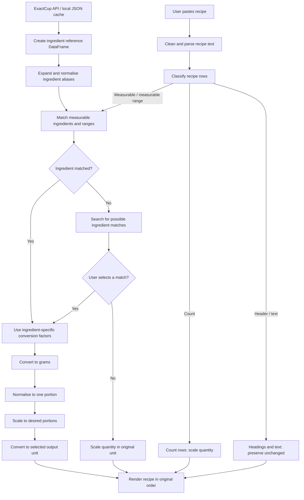

# The Information Lab - DEng Data School Application Example 1 - Recipe Unit Converter 
**Note — About this example**

> This application was developed as an example for The Information Lab's Data Engineering School application process.
>
> This example demonstrates how applications using a simple API and/or a small volume of data can incorporate more substantial transformation steps to demonstrate engineering skills and design decisions.
>
> The application uses a straightforward API containing just 80 ingredients, with minimal complexity in data ingestion. Instead, the main challenge lies in transforming unstructured, user-provided recipe text into usable data through quantity parsing, ingredient matching and unit conversions.

## 1. What I built and who for

The Recipe Unit Converter is an interactive recipe conversion application built with Python and Streamlit.

One of the most useful features a recipe website can offer is the ability to scale portion sizes or convert measurements between cups and grams, depending on the equipment you have to hand. When this functionality isn't built in, converting each ingredient individually can be a chore, particularly because different ingredients have different densities, making conversions between weight and volume difficult to approximate. As someone who enjoys baking, I wanted to create a tool that makes this process quick and easy.

The application allows users to paste an ingredient list, adjust the number of portions and convert between weight and volume measurements using ingredient-specific conversion factors.

Rather than requiring carefully formatted input, it attempts to interpret ordinary recipe text while preserving the structure of the original ingredient list in the output.

Key functionality includes:

- **Flexible recipe parsing:** Recognises different quantity formats, measurement units, ranges, countable ingredients, headings and unparsed text.
- **Ingredient matching:** Matches ingredients against an external reference dataset using canonical names and aliases, offering alternative selections where needed.
- **Unit conversion and scaling:** Converts between supported weight and volume units using ingredient-specific conversion factors, while adjusting quantities for different portion sizes.
- **Recipe structure preservation:** Retains ingredient order, section headings and unparsed text in the converted output.


## 2. The data

The application uses the ExactCup API, a small JSON dataset providing ingredient names, aliases and ingredient-specific conversion factors.

The reference data is retrieved using Python's requests library and cached locally as ingredients.json.

Because the reference dataset is relatively small and does not require frequent updates, the application uses a manual refresh policy. Once the cached data is at least 30 days old, users can request an update.

New responses are checked before replacing the existing cache, helping preserve usable reference data if a refresh fails.

The reference data is then transformed into two Pandas DataFrames:
- **Ingredient reference table:** Retains canonical ingredient information and conversion factors.
- **Alias lookup table:** Expands alternative ingredient names into individual rows, each associated with the relevant canonical ingredient identifier (slug).
This reshaping allows recipe ingredients to be matched using normalised names and DataFrame joins, without repeatedly searching nested JSON structures.

## 3. How it works

The application combines two inputs: structured reference data from ExactCup and unstructured recipe text provided by the user.

### Parsing the recipe

The parser processes the ingredient list line by line. It removes leading formatting characters, identifies recipe headings, extracts quantities and units, and classifies rows according to how they can be processed.

Supported quantity formats include ordinary numbers, decimals, fractions, selected Unicode fractions, mixed numbers, attached units and numerical ranges. Measurement units are standardised into a consistent vocabulary, while ingredient names are separated from quantities and optional notes. The result is a structured DataFrame in which each line has a row type determining its subsequent processing.

### Matching ingredients

Measurable ingredients are matched against the expanded ExactCup alias table. Ingredient names are normalised to reduce differences caused by capitalisation, hyphenation and whitespace.

Where an exact match cannot be found, the application can attempt alternative matching strategies, including handling some ingredient descriptions containing the word "or". If matching is unsuccessful, users may be offered candidate ingredients to select manually. 

Ingredients that remain unmatched can still be scaled in their original units, but cannot use the reference-data conversion functionality.

### Converting and scaling

Matched ingredients are first converted into grams using ingredient-specific conversion factors. Grams provide a common intermediate unit for portion scaling and subsequent conversion into the desired output unit.

Other ingredient types follow separate processing rules. For example, countable ingredients can be scaled without requiring conversion factors, while unparsed text is preserved.
A row identifier allows processed ingredient data to be associated with its original position, maintaining recipe structure in the final output.


### Engineering decisions

Several design decisions were made to balance efficiency, flexibility and reliability across the pipeline:

- **Controlled caching:** The API response is cached locally to avoid unnecessary requests. Refreshes are user-initiated and only available once the cache is at least 30 days old. New data is written to a temporary file before replacing the existing cache, protecting against failed updates.
- **Reshaping reference data:** Ingredient aliases are expanded into a separate lookup table, with one row per name and canonical ingredient identifier (`slug`). This simplifies matching using normalised names and DataFrame joins.
- **Separating parsing and matching:** Recipe text is parsed and classified before ingredient matching takes place. This keeps text interpretation separate from reference-data lookup and allows different row types to follow appropriate processing paths.
- **Handling unmatched ingredients:** When an ingredient cannot be matched directly to the reference data, the application searches for possible alternatives and offers these in a dropdown for the user to select. This allows ingredients with less specific names (e.g. "sugar") to be converted using the appropriate ingredient's conversion factors.
- **Converting through grams:** All matched ingredients are first converted to grams using their ingredient-specific conversion factors. This provides a common unit for scaling portions and converting into the user's chosen output unit, rather than requiring separate conversions between every possible pair of units.
- **Preserving recipe structure:** Original row identifiers and text are retained so the output maintains ingredient order, section headings and information that cannot be reliably converted.




## 4. How to run it

The application is built using Python, Pandas and Streamlit. It requires an internet connection on the first run to retrieve ingredient reference data from the ExactCup API. Subsequent runs use the locally cached JSON file.

```bash
git clone <repo-url>
cd <repo-name>

# Create and activate a virtual environment
python -m venv .venv

# Windows
.venv\Scripts\activate

# macOS / Linux
# source .venv/bin/activate

# Install dependencies
pip install -r requirements.txt

# Launch the application
python -m streamlit run app.py
```

On first launch, the application fetches ingredient reference data and saves it locally as `ingredients.json`. If a valid cache already exists, it is loaded instead, without making an API request.

## 5. What I would do next

A few improvements could make the application more reliable and flexible:

**Ingredient matching:** The current handling of alternatives (e.g. "sunflower or rapeseed oil") is limited, and the output doesn't explicitly identify which ingredient was matched. Showing the matched ingredient would make conversions more transparent.

**Parsing coverage:** Some recipe formats aren't fully supported, including:

- `2–3 onions` — count ranges aren't recognised and scaled.
- `11/2 cups flour` — interpreted as 5.5 rather than a potentially intended 1.5.
- `a heaped tablespoon of sugar` — descriptive quantities aren't recognised.

**Preserving recipe details:** Notes following commas (e.g. "finely chopped") are extracted during parsing but aren't consistently displayed in the output.

**Testing and data validation:**  Checks on refreshed API data could flag duplicate aliases, missing conversion factors or changes to the expected data structure before the reference tables are rebuilt.

## 6. Where AI helped

AI was used to write much of the code for this project, but the application was developed step by step, with the approach, engineering decisions and testing guided by human input throughout.

For the Streamlit interface, AI took on more of the implementation. I created a design sketch and used AI to implement the layout and CSS, an area I had little prior experience with. I then tested the output and provided feedback over several iterations until it matched the intended design.
